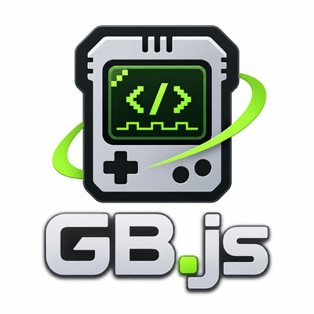

<p align="center">
  
</p>

<p align="center">
  <a href="https://www.npmjs.com/package/@rawify/gb">
    
  </a>
  <a href="https://opensource.org/licenses/MIT">
    
  </a>
</p>

# GB.js

GB.js is a headless, hardware-oriented Game Boy, Game Boy Color, and Game Boy Advance emulator written in TypeScript.

Most emulators are built as applications: they load a game, display a screen, play sound, and accept controller input. GB.js takes a different approach. It provides the underlying emulation components without imposing a user interface, rendering framework, audio backend, or storage mechanism.

This makes GB.js useful for building custom emulators, inspecting cartridges, experimenting with console hardware, and writing deterministic tests against emulated systems.

The focus is on **accuracy, reproducibility, and control**. CPU instructions, memory access, timers, DMA, graphics, and audio are modeled as interacting hardware components rather than independent approximations.

> **Development status:** GB.js is under active development. The current package version described here is `@rawify/gb@0.1.0`. It contains substantial working emulation subsystems, but does **not** yet provide complete compatibility with commercial games or every hardware revision. See [Current status](#current-status).

## Features

- **Three console families:** Game Boy, Game Boy Color, and Game Boy Advance.
- **Headless architecture:** Supply your own display, audio output, input handling, and storage.
- **Deterministic execution:** Step the emulated hardware and advance it through explicit clock cycles.
- **Cartridge inspection:** Identify GB, CGB, and GBA ROMs and validate their headers.
- **Hardware-oriented emulation:** CPU, memory buses, interrupts, DMA, timers, video, and sound are developed around real hardware behavior.
- **Save-data support:** Supported cartridge RAM, EEPROM, and Flash devices can be persisted by the host application.
- **TypeScript-first API:** Type declarations and ESM, CommonJS, and browser bundles are included.
- **Conformance testing:** Development uses established hardware test ROMs and reference outputs, with optional locally supplied BIOS images.

## Installation

Install GB.js from npm:

```bash
npm install @rawify/gb
```

Node.js **20 or newer** is required. The package also includes browser bundles and TypeScript declarations.

The API is organized into three entry points:

| Import | Purpose |
| --- | --- |
| `@rawify/gb` | Cartridge detection and header inspection |
| `@rawify/gb/gb` | Game Boy and Game Boy Color components |
| `@rawify/gb/gba` | Game Boy Advance components |

ROMs, BIOS images, and games are **not distributed** with the library.

## Getting started

### Identify a cartridge

Before emulating a game, you can inspect its ROM header to determine the console family and extract cartridge metadata:

```ts
import { parseROMHeader } from '@rawify/gb';

const rom = new Uint8Array(/* ROM file contents */);
const cartridge = parseROMHeader(rom);

console.log(cartridge.model);
console.log(cartridge.header.title);
```

`parseROMHeader()` strictly validates the boot header. For homebrew development or analysis of malformed ROMs, `parseGameBoyHeader()` and `parseGameBoyAdvanceHeader()` also accept `{ strict: false }`.

### Run a Game Boy Advance CPU

The GBA system coordinates CPU execution with the rest of the emulated hardware through a shared scheduler:

```ts
import { GameBoyAdvanceSystem } from '@rawify/gb/gba';

const gba = new GameBoyAdvanceSystem({ rom });

gba.step();           // Execute one CPU instruction
gba.runCycles(1024);  // Advance the system by 1024 cycles
```

When a BIOS image is not supplied, execution begins at `0x08000000`. A small set of common BIOS software interrupts (`Div`, `DivArm`, `Sqrt`, `CpuSet`, and `CpuFastSet`) is handled through high-level emulation. Passing `bootROM` instead starts execution at the reset vector and disables those replacements.

This is a low-level execution interface, not a ready-made game player. Your application is responsible for loading ROM bytes and connecting any desired frontend.

## Game Boy and Game Boy Color

The GB/CGB implementation exposes cartridge mappers, a memory bus, an SM83 instruction decoder, and increasingly detailed video, audio, and peripheral emulation.

### Cartridge banking and save data

Game Boy cartridges do not all use the same memory layout. Many games switch ROM banks, use battery-backed RAM, or include a real-time clock. GB.js provides cartridge implementations for:

- ROM-only cartridges
- MBC1 and MBC1M
- MBC2
- MBC3 and MBC30, including RTC state
- MBC5, including rumble callbacks

```ts
import { createGameBoyCartridge } from '@rawify/gb/gb';

const cartridge = createGameBoyCartridge(rom, {
  now: () => Date.now(),
  onRumble: (enabled) => console.log('Rumble:', enabled),
});

cartridge.write(0x2000, 3); // Select a ROM bank
const value = cartridge.read(0x4000);

const save = cartridge.dumpRAM();
```

Use `loadRAM()` to restore persistent data. A cartridge `reset()` resets mapper registers without deleting saved RAM or RTC state. Unsupported cartridge hardware raises `UnsupportedMapperError` instead of silently behaving as a different mapper.

### Graphics and framebuffer

Unlike a renderer that simply draws an entire frame at once, the Game Boy PPU advances through LCD dots and fetches background, window, and sprite data as the hardware would.

This matters because games can change registers *during* a scanline. Sprite fetching, window activation, VRAM restrictions, and the exact timing of LCD modes may all affect the resulting image.

The memory bus owns a **160 × 144** framebuffer containing row-major `0xAARRGGBB` pixels:

```ts
import { DMGBus, createGameBoyCartridge } from '@rawify/gb/gb';

const bus = new DMGBus({
  cartridge: createGameBoyCartridge(rom),
  framePalette: [
    0xffe8f8d8,
    0xffa8c878,
    0xff486838,
    0xff183818,
  ],
  onFrame: (frame, frameNumber) => {
    // Present the completed frame in your frontend.
    console.log(frameNumber, frame.width, frame.height);
  },
});

bus.tick(70224); // One nominal GB frame in T-cycles

const { width, height, pixels } = bus.frame;
```

The framebuffer is reused across frames. Make a copy of `pixels` if you need to retain earlier images.

DMG rendering covers background and window tiles, sprites, palettes, scrolling, and pixel priority. CGB mode adds color palettes, tile attributes, VRAM/WRAM banking, speed switching, and revision-dependent behavior. The implementation also models dotwise fetcher/FIFO activity, bus contention, and selected timing-sensitive hardware quirks.

### Sound generation

The Game Boy has four sound channels: two pulse generators, one programmable wave channel, and one noise generator. GB.js clocks these through the same time domain as the CPU and display rather than treating sound as an unrelated background process.

```ts
const bus = new DMGBus({
  cartridge: createGameBoyCartridge(rom),
  audioSampleRate: 48000,
  audioBufferCapacity: 16384,
});

bus.tick(70224);

const { left, right, sampleRate } = bus.drainAudio();
// Send the Float32Array channels to your audio backend.
```

The APU supports channel envelopes, sweep, length counters, wave RAM access rules, stereo routing, and deterministic PCM resampling. It also models a number of DMG/CGB revision-specific effects, including wave RAM timing and selected register-write quirks.

`drainAudio()` consumes the currently buffered samples without resetting the sampling phase. The audio output is not tied to Web Audio or any particular playback library.

### Serial communication

The serial interface can exchange individual bits with a custom endpoint. That makes it possible to connect two emulated Game Boy buses or attach a simulated peripheral:

```ts
const slave = new DMGBus({ cartridge: slaveCartridge });

const master = new DMGBus({
  cartridge: masterCartridge,
  serialEndpoint: {
    exchangeBit: (outgoingBit) => slave.clockSerial(outgoingBit),
  },
});
```

Internal and external serial clocks, transfer completion interrupts, and CGB fast serial mode are supported.

## Game Boy Advance

The GBA implementation includes an executable **ARM7TDMI** CPU, ARM and Thumb instruction pipelines, a physical memory map, and a deterministic master scheduler.

The scheduler is central to the design: peripherals share a common notion of elapsed cycles, allowing DMA transfers, timer overflows, graphics events, and interrupts to influence CPU execution.

### CPU and memory

The CPU implements ARMv4T instruction families, condition evaluation, banked registers, processor status registers, ARM/Thumb switching, and exception handling. Memory timing includes physical bus widths, `WAITCNT`, and Game Pak instruction prefetch behavior.

`IE`, `IF`, and `IME` control interrupts, while HALT and STOP suspend execution according to their respective wake conditions.

### Timers and DMA

Four hardware timers support programmable prescalers, reload values, cascade operation, and overflow interrupts.

Four DMA channels support 16- and 32-bit transfers, address modes, priority arbitration, repeating transfers, completion interrupts, and CPU stalls. Transfers can be triggered immediately, by HBlank/VBlank, or by supported special events such as Direct Sound FIFO refills.

### Video

The GBA video system produces a **240 × 160** RGBA framebuffer. Implemented rendering features include:

- Text and affine backgrounds, plus bitmap modes 3, 4, and 5
- Regular and affine sprites, including double-size affine objects
- Layer priorities, transparency, windows, and object windows
- Alpha blending, brightness effects, and mosaic
- Scanline scheduling, display interrupts, and video-triggered DMA

Video memory access and sprite evaluation follow modeled PPU scheduling constraints. Some mid-scanline effects and specialized hardware behavior remain incomplete.

### Audio

The GBA sound subsystem combines four legacy programmable sound generators with **Direct Sound FIFO A and B**. It includes timer-driven FIFO consumption, DMA refill requests, left/right routing, volume controls, and buffered stereo PCM output.

```ts
const audio = gba.drainAudio();
// Consume the generated audio in your application.
```

### Save memory, RTC, and input

GBA cartridges advertising supported save signatures can use EEPROM, SRAM, Flash512, or Flash1M storage. `GameBoyAdvanceSystem` accepts `saveData` to restore stored bytes and `onSaveWrite` for host-side persistence.

Cartridges advertising `SIIRTC_V` can expose a GPIO-connected real-time clock, with options for supplying a clock function and restoring RTC state.

The keypad maps all ten GBA buttons through `KEYINPUT` and supports `KEYCNT` keypad interrupts. The system exposes host input through `setButton()`.

Normal 8-bit and 32-bit GBA serial transfers are implemented with pluggable bit endpoints. Multiplayer, UART, and Joy Bus protocol engines are not yet implemented.

## Accuracy and hardware revisions

GB.js aims to reproduce observable hardware behavior, not merely the final result of a game frame.

For example, the order in which a Game Boy fetches tiles, pauses for sprites, and starts drawing its window can affect pixels and interrupt timing. On the GBA, DMA bus occupancy and cartridge wait states can change when the CPU executes its next instruction.

These details matter for hardware tests, demos, timing-sensitive software, and research into how the original consoles behave.

CGB hardware revisions are not identical. When using `DMGBus` with `model: 'cgb'`, the `cgbRevision` option accepts `'0'`, `'a'`, `'b'`, `'c'`, `'d'`, or `'e'`; the default is `'c'`. Implemented revision profiles distinguish selected register read masks, PPU timing, bus conflicts, and audio edge cases.

**Accuracy is a development goal, not a claim that every subsystem is cycle-perfect.** In particular, some DMA corruption cases, unusual audio timing boundaries, specialized peripherals, and GBA mid-scanline effects are still open.

## Current status

GB.js `0.1.0` is best viewed as a hardware emulation toolkit under development, rather than a finished all-games emulator.

| Component | Current implementation |
| --- | --- |
| GB/CGB cartridge inspection | Header validation and identification |
| GB/CGB cartridge mappers | ROM-only, MBC1/MBC1M, MBC2, MBC3/MBC30, MBC5 |
| GB/CGB CPU | Base and CB-prefixed SM83 decoder, initial interrupt/HALT sequencing |
| GB/CGB graphics | Dotwise LCD renderer, framebuffer, CGB color and selected revision-specific timing |
| GB/CGB audio | Four-channel APU, PCM output, detailed selected DMG/CGB quirks |
| GB/CGB peripherals | Timers, OAM DMA, CGB DMA, joypad, serial communication |
| GBA CPU | ARM7TDMI ARM/Thumb execution, exceptions, bus and wait-state timing |
| GBA graphics | Scanline PPU, backgrounds, objects, effects, framebuffer |
| GBA audio | Legacy PSG, Direct Sound FIFO A/B, PCM output |
| GBA peripherals | Interrupts, timers, DMA, keypad, RTC, partial SIO |
| GBA save storage | EEPROM, SRAM, Flash512, Flash1M |

A feature appearing in this table means that an implementation exists, **not** that all games, timing corner cases, or hardware variants have been validated. The detailed implementation boundaries are recorded in the [architecture document](https://github.com/rawify/GB.js/blob/main/docs/architecture.md).

## Testing and development

Node.js 20 or newer is required. Install the exact development dependencies from the lockfile:

```bash
npm ci
```

The default test command builds the package, type-checks the source, runs ESLint, and executes the unit suite:

```bash
npm test
```

Unit tests and their fixtures are part of the repository. They do not require downloaded ROMs, BIOS images, or network access.

### Conformance tests

Hardware conformance suites are deliberately not committed to this repository or published in the npm package. To prepare them locally, run:

```bash
npm run data:fetch
npm run data:build
npm run data:verify
```

`data:fetch` downloads pinned public test releases and checks out pinned source revisions. `data:build` requires `make` and `unzip`; building the mGBA suite additionally requires devkitARM or Docker. All generated and downloaded files remain below the ignored `test-data/` directory.

After setup, run the conformance suite with:

```bash
npm run test:conformance
```

The command uses `test-data/roms` by default. Set `GAMEBOY_TEST_ROMS` only when the prepared ROM directory is elsewhere. Missing or incomplete test data causes the command to fail instead of silently skipping the suite.

The tests include selected Mooneye checks, SameBoy/SameSuite cases, DMG and CGB display references, and mGBA Suite groups. They cover specific hardware properties and should not be interpreted as blanket compatibility certification.

### Local firmware

Original Nintendo BIOS files and commercial ROMs are not bundled. If you have dumped firmware from hardware you own, you can import it for local tests:

```bash
npm run data:bios -- dmg /path/to/dmg-dump.bin
npm run data:bios -- cgb /path/to/cgb-dump.bin
npm run data:bios -- gba /path/to/gba-dump.bin
```

The import command verifies known firmware hashes and stores accepted files below `test-data/`. These files remain local and are never included in the repository or npm package. See [CONTRIBUTING.md](https://github.com/rawify/GB.js/blob/main/CONTRIBUTING.md) for the complete contribution workflow.


## Design philosophy

GB.js keeps emulation separate from presentation. A renderer does not need to know how an SM83 executes instructions, and the CPU does not need to know whether its framebuffer will be displayed in a browser, recorded for a test, or consumed by a custom visualization.

The same principle applies to time: explicit clock advancement and injectable host services make execution easier to reproduce, inspect, and test.

The result is a library intended to be **embedded, extended, and studied**—with hardware details available when you need them and no mandatory frontend when you do not.


## Copyright and license

Copyright (c) 2026 [Robert Eisele](https://raw.org/)

Licensed under the MIT License.